

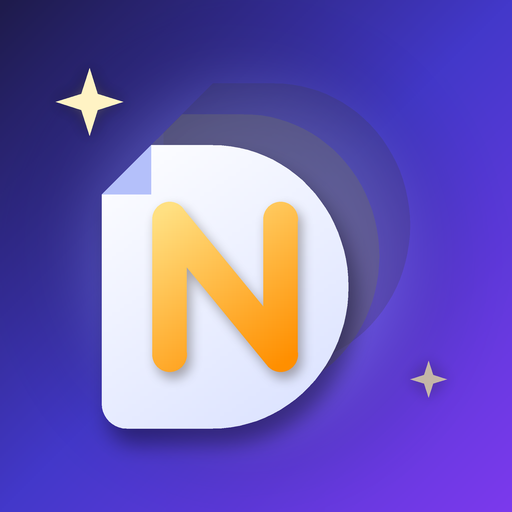

# DocSteep

### One organised home for your family's documents

**Private · Encrypted · Family-first**

*Version **1.0.4** is out now.*

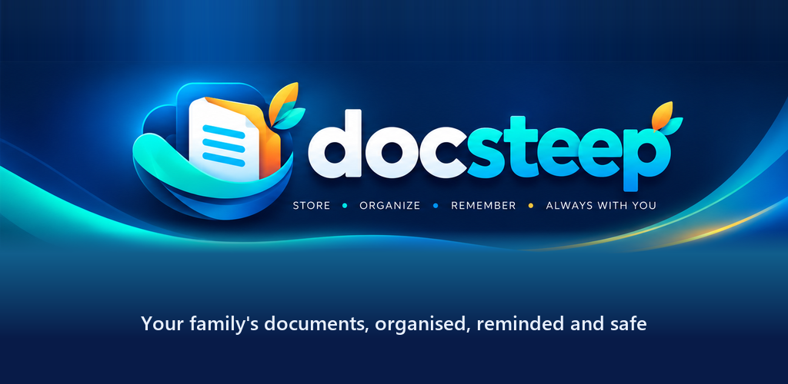

---

## 🆕 What's new in 1.0.4

The same private family vault, with a fresh new look.

- 🏷️ **Fresh logo.** The new DocSteep icon appears across the app in all 9 languages, and there's a new website at **[docsteep.snakri.space](https://docsteep.snakri.space)**.
- 💾 **Nothing to redo.** Updating keeps your documents, Drive backups, PIN and settings exactly as they are.
- 🏦 **New Banks & Loans category.** Passbooks, cards, FDs and every loan paper are grouped by bank, with maturity and loan-end reminders.

> Already installed? Open the Indus Appstore and tap **Update**.

---

## 📖 About DocSteep

Aadhaar, PAN, passports, insurance policies, school certificates, vehicle papers, bills… Every family keeps them somewhere, usually spread across drawers, WhatsApp chats and email inboxes. When you need one urgently, it is never at hand. When one expires, nobody notices until it is too late.

**DocSteep** was built to solve exactly that. It is a private, family-first home for the paperwork of life, and an assistant that tells you **what is missing, what is expiring and what needs your attention next**.

> 💡 DocSteep started as the developer's solution to their own family's document chaos. It is now available for every family.

---

## 📱 Screenshots

<table>
<tr>
<td align="center">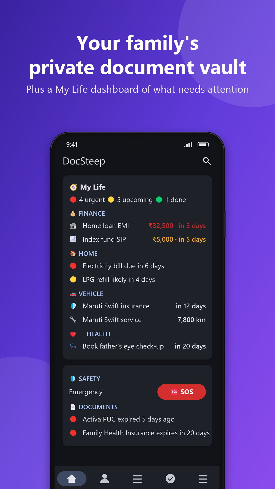 <b>My Life dashboard</b></td>
<td align="center">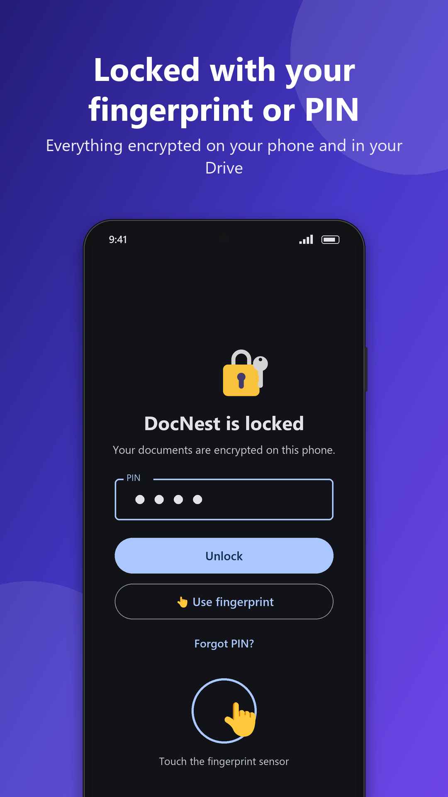 <b>PIN & fingerprint lock</b></td>
<td align="center">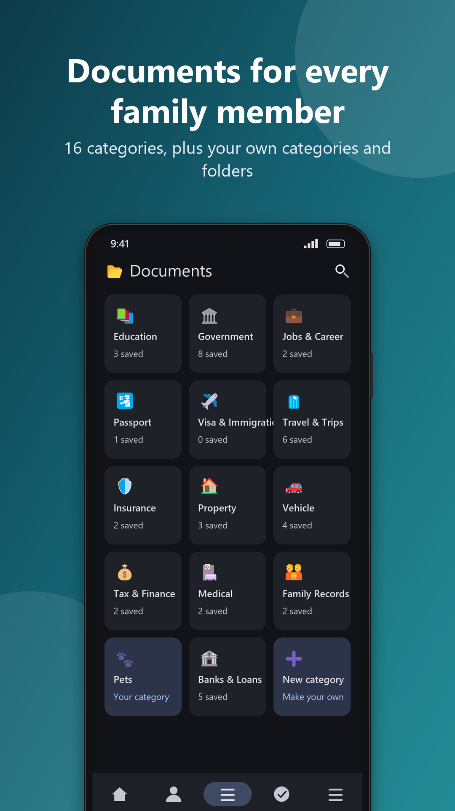 <b>Documents for everyone</b></td>
</tr>
<tr>
<td align="center">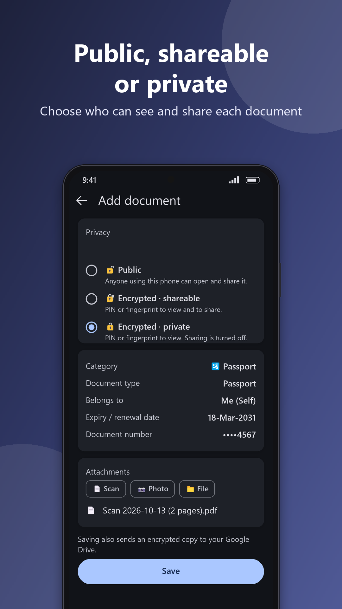 <b>Privacy per document</b></td>
<td align="center">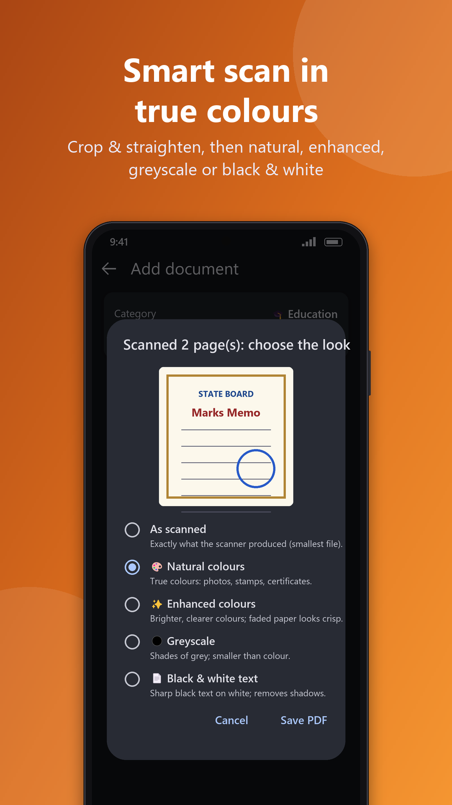 <b>Smart scan</b></td>
<td align="center">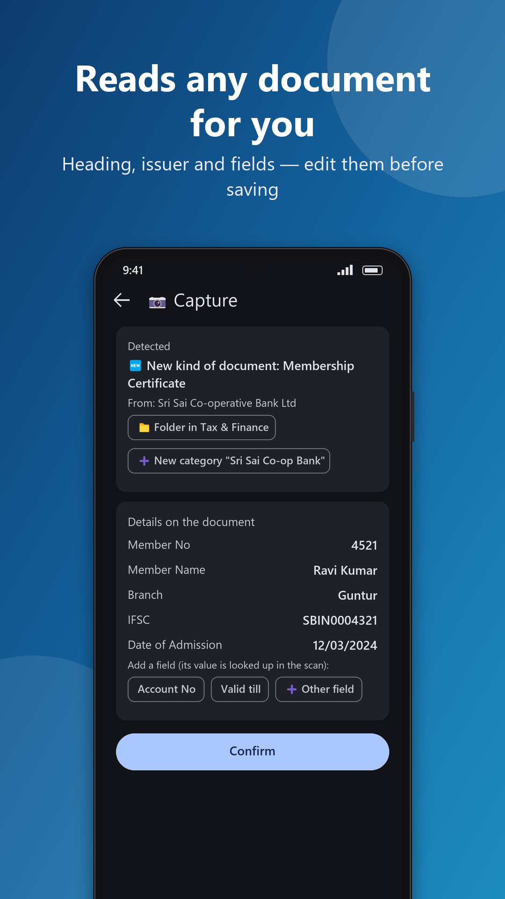 <b>Reads any document</b></td>
</tr>
<tr>
<td align="center">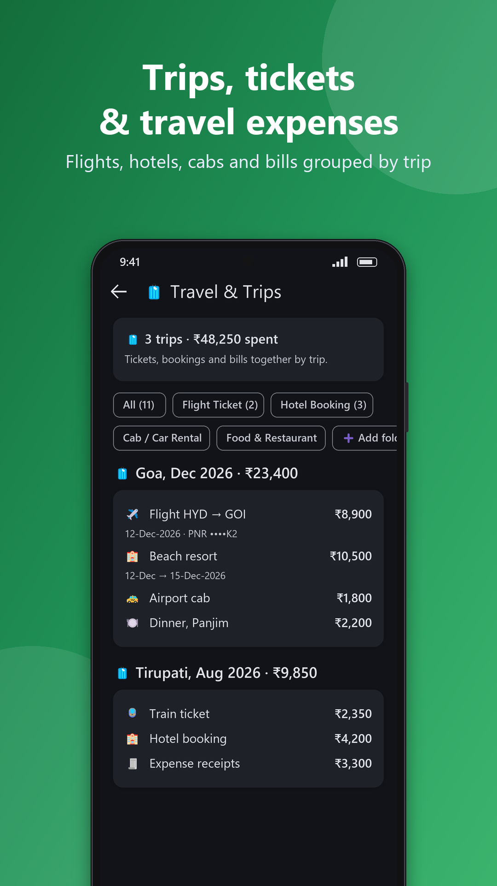 <b>Travel & trips</b></td>
<td align="center">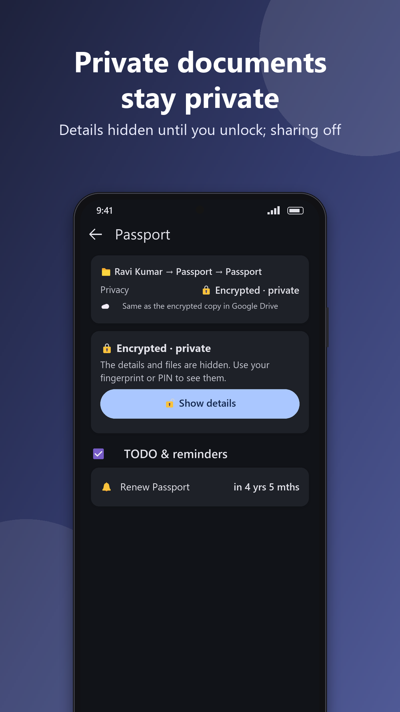 <b>Private stays private</b></td>
<td align="center">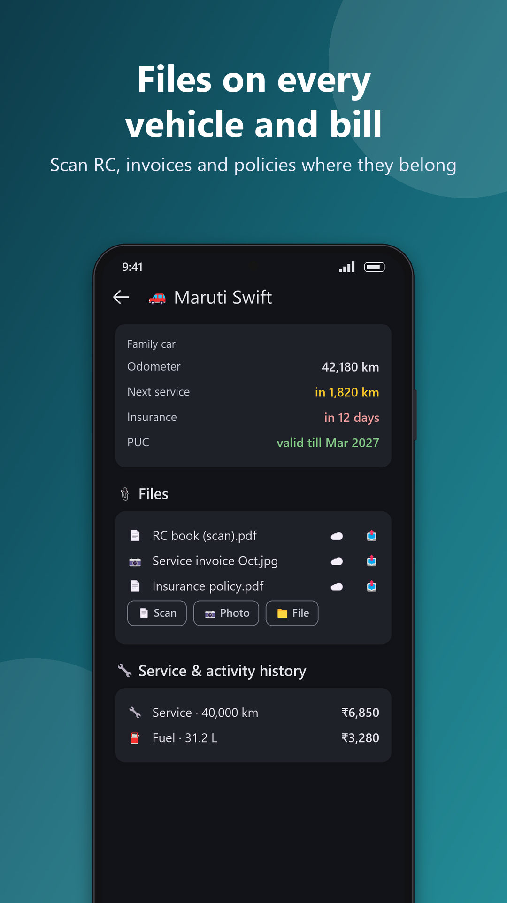 <b>Vehicles & files</b></td>
</tr>
<tr>
<td align="center">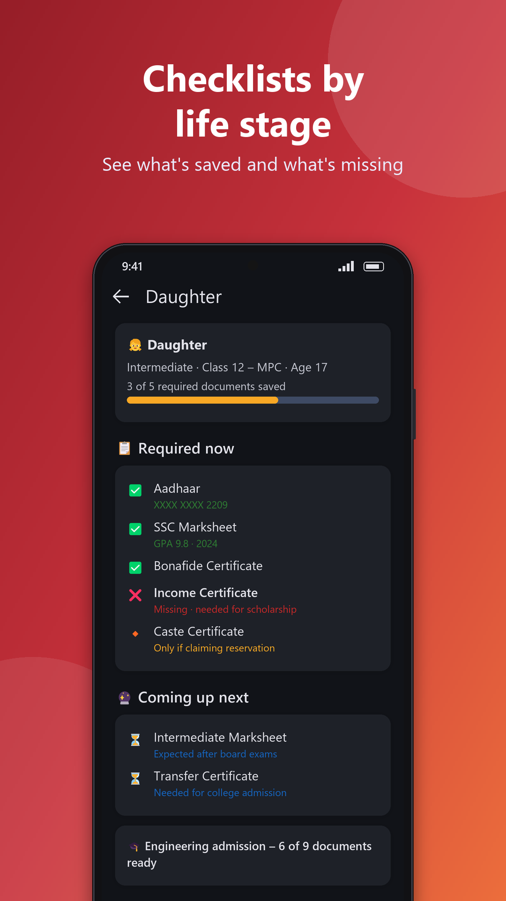 <b>Life-stage checklists</b></td>
<td align="center">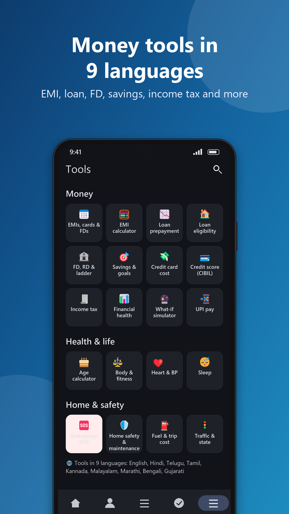 <b>Money tools</b></td>
<td align="center">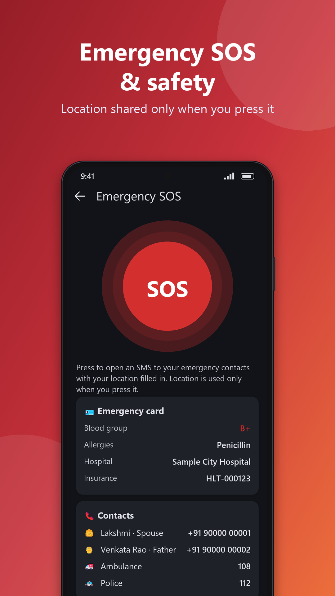 <b>Emergency SOS</b></td>
</tr>
</table>

---

## ✨ Features

<table>
<tr>
<td width="50%" valign="top">

### 📄 Documents for every family member
- Aadhaar, PAN, passport, certificates, marksheets, insurance, property, vehicle, tax, medical, agriculture and business papers
- **Life-stage checklists** (school, college, job, marriage, farmer, business owner, retired) show what's missing and what you'll need next
- Create your **own categories and folders**
- **Expiry and renewal reminders** for passport, licence, insurance, PUC and more

</td>
<td width="50%" valign="top">

### 📸 Smart scan & capture
- Scan up to **20 pages** with edge detection, crop and straighten
- Colour modes: natural, enhanced, greyscale or shadow-free black & white
- Attach existing PDFs, images and photos
- **Share to DocSteep** directly from Gmail, WhatsApp, Files or Photos
- Unknown document? DocSteep reads its heading and suggests where to file it

</td>
</tr>
<tr>
<td colspan="2" valign="top">

### 🏦 Banks & loans NEW in 1.0.4
- Passbooks, statements, cards, FDs, RDs and every loan paper, **grouped by bank**
- Loan and deposit totals, with **reminders before an FD matures, a loan ends or a card expires**

</td>
</tr>
<tr>
<td valign="top">

### 🔔 My Life dashboard
- One screen for everything urgent: bills, EMIs, card dues, FD maturities, insurance, vehicle service
- *"What should I do now?"* suggestions you can snooze or dismiss
- **Daily summary notification**

</td>
<td valign="top">

### 🧳 Travel & trips
- Flight, train and bus tickets, hotel and resort bookings, cabs, food and expense receipts
- **Grouped by trip with totals**
- Trip-planning checklists for **India and abroad**

</td>
</tr>
<tr>
<td valign="top">

### 🏠 Bills, utilities & vehicles
- Electricity, gas, water, internet and mobile: readings, due dates and refill patterns
- Vehicle KM log, **service prediction from your own history**, expenses, insurance and PUC status
- Attach scans and files to every connection and vehicle

</td>
<td valign="top">

### ✅ Tasks & applications
- To-dos, reminders and future requirements linked to any person, document or vehicle
- Ready checklists for **admissions, scholarships, passport, visa and loans**, automatically checked against your saved documents

</td>
</tr>
<tr>
<td valign="top">

### 🧮 Money tools
- EMI calculator and loan prepayment planner
- Home and personal loan eligibility
- FD, RD and FD-ladder planner, savings goals, credit-card cost calculator
- Income tax: **old vs new regime** comparison
- Financial health check and what-if simulator

</td>
<td valign="top">

### ❤️ Health, life & safety
- Age and retirement calculator, BMI, BMR, calories, body fat
- **Emergency SOS**: shares your location with your contacts *only when you press it*
- Encrypted emergency card (blood group, allergies, medicines)
- Home safety reminders and helplines

</td>
</tr>
</table>

### 🔍 Smart search
Search the way you think, for example *"what's due this month"*, *"car expenses"* or *"documents for college admission"*.

### 🌐 Your language
The whole app is available in **English, हिन्दी, తెలుగు, தமிழ், ಕನ್ನಡ, മലയാളം, मराठी, বাংলা and ગુજરાતી**.

---

## 🔐 Security: built in, not bolted on

Family documents are some of the most sensitive data you own, so DocSteep was designed with security as a core requirement from day one.

| Layer | How DocSteep protects you |
|---|---|
| 🔑 **Strong sign-in** | Google sign-in, followed by your own **app PIN**. Fingerprint unlock is optional. |
| 🔒 **Auto-lock** | The app locks itself when you leave it. |
| 🛡️ **Encrypted on your phone** | Every document, file and record is protected with **AES-256 encryption**. Keys are held in your phone's secure hardware-backed storage and never leave the device in readable form. |
| ☁️ **Encrypted backup** | Data is encrypted **again before it leaves your phone** and is backed up to **your own Google Drive**. Only your Google account can open it, so even someone with access to the Drive files sees nothing readable. |
| 🏷️ **Privacy levels per document** | Mark each document **Public**, **Encrypted · Shareable** or **Encrypted · Private**. |
| 👆 **Verified sharing** | Sharing asks for your fingerprint or PIN. Private documents can't be shared at all. |
| 📵 **Screen protection** | Screenshots and screen recording are blocked by default. You can change this in Settings. |
| 🧹 **Temporary files cleaned up** | Files you open or share use a temporary copy that is deleted within minutes. |
| 🚪 **Sign-out wipes the phone** | Signing out backs up your data and then wipes it from the device. Another account on the same phone never sees your data. |
| 📍 **No tracking** | No background location tracking. Nothing is shared without your action. |
| 🗑️ **You stay in control** | Delete all your data any time from Settings. |

> ✅ **Your data is yours.** DocSteep has no server-side copy of your documents. They live only on your phone and in your own Google Drive, encrypted.

---

## 🚀 Getting started

### 1. Install
Download DocSteep from the **[Indus Appstore](https://www.indusappstore.com/apps/productivity/docnest/com.docnest/?page=details&id=com.docnest)** on any Android phone (Android 8.0 or newer). You can also open the Indus Appstore, search for **"DocSteep"** and tap **Install**.

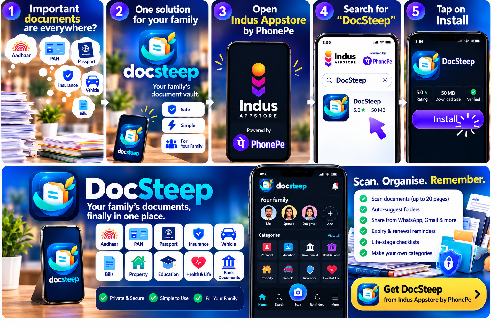

### 2. First-time setup
1. **Choose your language** and **sign in with Google**.
2. Fill in **"About you"**: your name and life stage.
3. **Set your app PIN.** You can also turn on fingerprint unlock.

### 3. Add your family
Go to **People** and add each family member with their life stage (student, working, retired, and so on). DocSteep instantly builds a checklist of the documents each person needs.

### 4. Add documents
1. Tap **➕ Add / Capture**.
2. Choose **Scan**, **Photo** or **File**. You can also share a file to DocSteep from WhatsApp, Gmail or any other app.
3. Pick the **person**, **category** and **document type**.
4. Add an **expiry date** if it has one, and choose a **privacy level**.
5. Tap **Save**. Done! ✅

### 5. Stay on top of things
- Open **Home / Today** each day to see what needs attention.
- Watch for the **daily summary notification** about upcoming expiries and dues.
- Use **Search** to find any document in seconds.

### 6. Explore more
| I want to… | Go to |
|---|---|
| Track a trip's tickets and expenses | **Documents → Travel & Trips** |
| Log electricity, gas or mobile bills | **Life & Services** |
| Record vehicle service and KM | **Vehicles** |
| Check documents for a passport, visa or admission | **Applications** |
| Set a reminder or to-do | **Tasks** |
| Plan an EMI, FD or income tax | **Tools** |
| Change security or language | **Settings** |

### 7. New phone? No problem
Install DocSteep on your new phone and **sign in with the same Google account**. Your encrypted backup is restored automatically.

---

## 🔗 Links

| | |
|---|---|
| 📲 **Download** | [Indus Appstore](https://www.indusappstore.com/apps/productivity/docnest/com.docnest/?page=details&id=com.docnest) |
| 🌐 **Website** | [docsteep.snakri.space](https://docsteep.snakri.space) |
| 🔏 **Privacy policy** | [docsteep.snakri.space/privacy.html](https://docsteep.snakri.space/privacy.html) |
| 📜 **Terms of use** | [docsteep.snakri.space/terms.html](https://docsteep.snakri.space/terms.html) |
| ⚠️ **Disclaimer** | [docsteep.snakri.space/disclaimer.html](https://docsteep.snakri.space/disclaimer.html) |
| 🗑️ **Delete your data** | [docsteep.snakri.space/delete-data.html](https://docsteep.snakri.space/delete-data.html) |
| ✉️ **Support** | [snakrispace@gmail.com](mailto:snakrispace@gmail.com) |

---

## 👨‍💻 Meet the developer

<table>
<tr>
<td width="180" valign="top">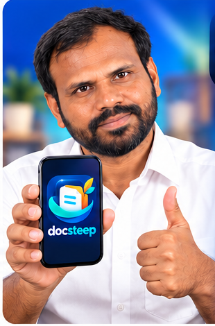</td>
<td valign="top">

### Dandu Ramakrishna
**Creator of DocSteep · Made in India 🇮🇳**

DocSteep started as a fix for my own family's paperwork: Aadhaar cards in one drawer, insurance in an inbox, school certificates in a WhatsApp chat, and renewals that slipped by unnoticed.

I built it to be private first, simple enough for everyone at home, and available in the languages Indian families speak. Your feedback shapes what comes next.

✉️ [snakrispace@gmail.com](mailto:snakrispace@gmail.com)

</td>
</tr>
</table>

---

## 💬 Feedback & support

Found a bug, have a feature idea, or need help?
- Open an **[issue](../../issues)** in this repository, or
- Email **[snakrispace@gmail.com](mailto:snakrispace@gmail.com)**

If DocSteep helps your family, please ⭐ **star this repo** and share it with someone who's always searching for *"that one document"*.

---

## ⚠️ Disclaimer

DocSteep is free to use and shows small, labelled sponsored banners on the Tools screens only. Calculators and suggestions are for education and planning only. They are not professional medical, tax, legal, insurance or investment advice. DocSteep is not affiliated with any government body, bank or credit bureau.

---

**DocSteep: one organised home for your family's documents.** 💙

Made with care in India 🇮🇳

